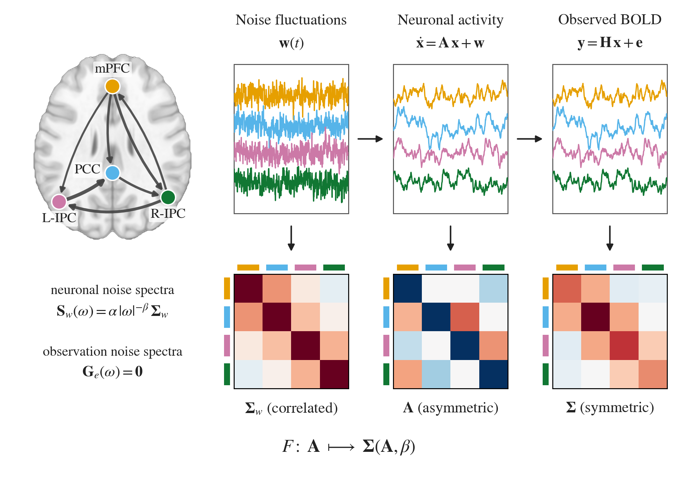

# A triple-operator decomposition of a map from causal to correlational brain connectivity at rest: intrinsic dynamics, temporal coloring, and spatial covariance

**Author:** Yaohui Ding, Ph.D.

## Project overview

Resting-state functional connectivity (RSFC) describes symmetric zero-lag covariance, whereas resting-state effective connectivity (RSEC) describes directed interactions within a dynamical model. In spectral dynamic causal modeling (DCM), their relationship is encoded by a matrix-valued frequency integral. This project derives that forward map analytically for linear neuronal dynamics governed by a real, Hurwitz-stable effective-connectivity matrix $\mathbf A$ and driven by multivariate Gaussian power-law noise with spatial covariance factor $\boldsymbol\Sigma_w$.

For two-region systems and diagonalizable $n\times n$ networks, the manuscript gives closed-form covariance formulae that allow asymmetric $\mathbf A$ and spatially correlated neuronal noise. It shows that steady-state covariance is the unique solution of a Lyapunov equation with connectivity-dependent forcing. At the white-noise limit $\beta=0$, this becomes the standard continuous-time Lyapunov equation. Vectorizing the solution exposes a three-factor forward map,

$$
\operatorname{vec}(\boldsymbol\Sigma)
=\mathcal P_{\mathbf A}\,\mathcal T_{\beta,\mathbf A}\,\mathbf v_w,
$$

separating intrinsic dynamical propagation (mean reversion), connectivity-dependent scale-free temporal coloring, and spatial covariance structure. The analysis also extends to region-specific noise exponents.



## Repository structure

```text
.
├── README.md
├── corr_causation_map_decomposition.tex
├── corr_causation_map_decomposition.bib
├── nomenclature.md
├── appendices/
│   ├── appendix_a_cov_formula_dyad.tex
│   ├── appendix_b_cov_formula_nbyn_lyapunov.tex
│   ├── appendix_a_cov_formula_dyad.newpax
│   ├── appendix_b_cov_formula_nbyn_lyapunov.newpax
│   ├── bibcites.tex
│   ├── extract_newpax.tex
│   └── build/
├── figures/
│   └── spectral_dcm_schematic/
│       ├── spectral_dcm_schematic.py
│       ├── spectral_dcm_schematic.pdf
│       ├── spectral_dcm_schematic.png
│       ├── make_brain_axial.py
│       ├── brain_axial.png
│       └── brain_axial.json
└── build/
```

Key files and directories:

- `corr_causation_map_decomposition.tex` is the main manuscript and contains the consolidated References section.
- `appendices/appendix_a_cov_formula_dyad.tex` derives the two-region covariance formula by reducing the matrix-valued integral to scalar integrals.
- `appendices/appendix_b_cov_formula_nbyn_lyapunov.tex` treats general networks, derives the Lyapunov and vectorized solutions, and extends them to region-specific noise exponents.
- `nomenclature.md` is the notation and terminology registry.
- `appendices/bibcites.tex` supplies the standalone appendices with citation labels from the main manuscript.
- The `.newpax` files in `appendices/` preserve hyperlinks when the standalone appendix PDFs are embedded in the main manuscript.
- `build/` and `appendices/build/` contain generated compilation artifacts.

## Reproducibility

### Reproducing Figure 1

The schematic requires Python 3 with NumPy, SciPy, and Matplotlib. From the project root:

```bash
cd figures/spectral_dcm_schematic
python3 spectral_dcm_schematic.py
```

The script checks that the illustrative connectivity matrix is Hurwitz stable, that the spatial covariance factor is positive definite, and that the frequency integral agrees with the standard Lyapunov solution when $\beta=0$. It writes the manuscript PDF and the README PNG.

### Building the manuscript

A recent TeX Live distribution with `latexmk`, LuaLaTeX, `xr-hyper`, `pdfpages`, and `newpax` is required. The appendices are compiled separately and embedded in the main PDF. Build in dependency order from the project root:

```bash
latexmk -pdf -interaction=nonstopmode -outdir=build corr_causation_map_decomposition.tex

cd appendices
latexmk -pdf -interaction=nonstopmode -outdir=build appendix_a_cov_formula_dyad.tex
latexmk -pdf -interaction=nonstopmode -outdir=build appendix_b_cov_formula_nbyn_lyapunov.tex
lualatex -interaction=nonstopmode -output-directory=build \
extract_newpax.tex
cd ..

latexmk -pdf -interaction=nonstopmode -outdir=build corr_causation_map_decomposition.tex
```

The final combined manuscript is written to `build/corr_causation_map_decomposition.pdf`. Appendix B depends on Appendix A through `xr-hyper`, and Appendix A refers to equations in the main manuscript, so the order above should be preserved. If bibliography entries or their ordering change, refresh `appendices/bibcites.tex` from the `\bibcite` entries in the main auxiliary file before rebuilding the appendices.

## Data and code availability

No experimental or simulated datasets are analyzed. The figure-generation code and all LaTeX sources needed to reproduce the manuscript are included in this repository.

## License 

Copyright © 2026 Yaohui Ding. All rights reserved.


